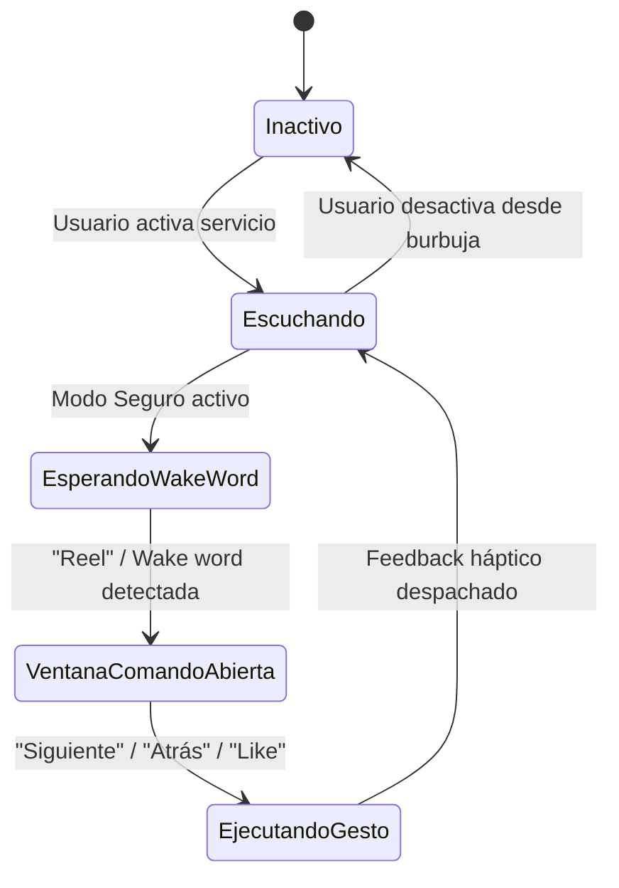

# Arquitectura Técnica :: ReelVoice-Android

Documento técnico de arquitectura del sistema de control por voz y gestos de accesibilidad.

---

## 1. Diagrama de Flujo del Pipeline de Audio y Gestos

```mermaid
flowchart TD
    subgraph Captura["🎙️ Capa de Audio"]
        Mic["Entrada de Micrófono"] --> RecMgr["VoiceRecognitionManager"]
        FGS["ReelVoiceForegroundService"] -.->|"Mantiene vivo (FOREGROUND_MICROPHONE)"| RecMgr
    end

    subgraph Inteligencia["🧠 Procesamiento y Filtro"]
        RecMgr --> Norm["Normalización y Fonética"]
        Norm --> Leven["Fuzzy Matcher (Distancia Levenshtein)"]
        Leven --> CheckWake{"¿Requiere Wake Word?"}
        CheckWake -- Sí, pero no detectada --> Descarte["Descartar entrada"]
        CheckWake -- Superado / Desactivado --> CmdMap["Mapeo a VoiceCommand"]
    end

    subgraph Accion["⚡ Despacho de Acciones"]
        CmdMap --> Dispatch{"Tipo de Comando"}
        Dispatch -->|Audio/Mute| AudioMgr["AudioManager del Sistema"]
        Dispatch -->|Feedback UI| Bubble["FloatingBubbleService (Overlay)"]
        Dispatch -->|Scroll/Gestos| AccService["ReelVoiceAccessibilityService"]
    end

    subgraph Pantalla["📱 Dispositivo Android"]
        AccService -->|dispatchGesture (SwipeUp)| NextReel["Siguiente Reel / Short"]
        AccService -->|dispatchGesture (DoubleTap)| LikeAction["Dar Like"]
        AccService -->|dispatchGesture (Tap)| PauseAction["Pausar Video"]
    end
```

---

## 2. Diagrama de Estados del Reconocimiento



---

## 3. Componentes Principales
- **`ReelVoiceForegroundService`**: Servicio en primer plano persistente para captura ininterrumpida de audio.
- **`VoiceRecognitionManager`**: Motor de voz, supresión de beeps de Android y tolerancia a fonética latina.
- **`ReelVoiceAccessibilityService`**: Despacho de gestos nativos sin depender de APIs de apps terceras.
- **`FloatingBubbleService`**: Ventana flotante de control rápido con animaciones de auto-dimming.
