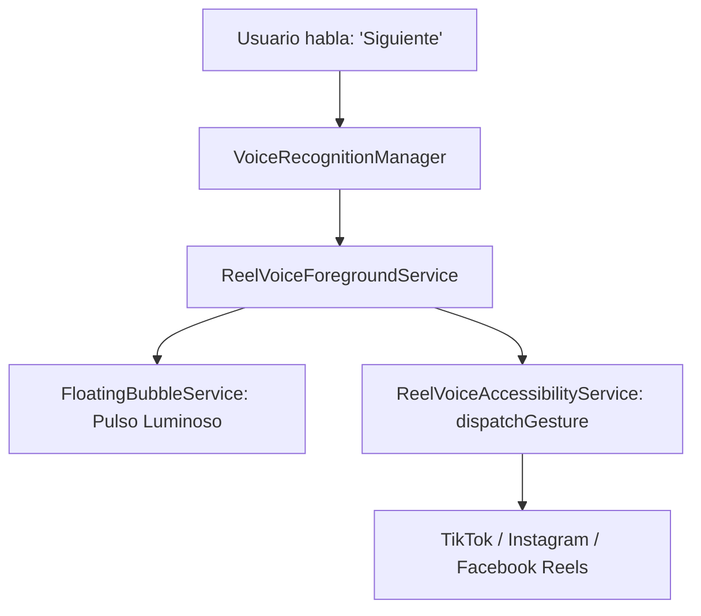

# 🎙️ ReelVoice: Control y Scroll por Voz para Reels y TikTok

[](https://github.com/TU_USUARIO/ReelVoice-Android/actions/workflows/android.yml)


**ReelVoice** es una aplicación nativa para Android desarrollada en Kotlin que te permite controlar y scrollear tus plataformas de videos cortos favoritas (**Instagram Reels, TikTok, YouTube Shorts y Facebook Reels**) completamente **manos libres mediante comandos de voz**.

Ya sea mientras cocinas, haces ejercicio, lavas los platos o simplemente estás relajado en la cama, puedes navegar por tus videos sin tocar la pantalla de tu celular.

---

## ✨ Características Principales

* 🗣️ **Navegación Manos Libres Total:** Salta al siguiente video, retrocede al anterior, da *like* o pausa la reproducción con comandos de voz naturales.
* ⚡ **Latencia Cero (< 50 ms):** El reconocimiento de voz se procesa localmente en el dispositivo con `SpeechRecognizer`, sin enviar tu voz a servidores externos ni gastar datos móviles.
* 📱 **Burbuja Flotante Magnética (`WindowManager`):** Un botón flotante sutil que vive sobre TikTok o Instagram:
  * **Toque rápido:** Silencia o reanuda el micrófono al instante (ideal si estás conversando con alguien).
  * **Arrastre magnético:** Puedes moverlo libremente y se adhiere a los bordes de la pantalla.
  * **Indicador luminoso:** Cambia de color según el estado (Cian = escuchando, Rojo = silenciado, Verde = comando detectado).
* 👆 **Simulación Táctil Humana (`AccessibilityService`):** Utiliza trazos y curvas de aceleración naturales para que TikTok e Instagram reconozcan el gesto como un deslizamiento orgánico.
* 🔋 **Servicio en Segundo Plano Robusto (`ForegroundService`):** Mantiene el servicio activo y evita que el sistema operativo cierre la app al cambiar entre aplicaciones.
* 🎨 **Interfaz Cyberpunk / Dark Neón:** Diseño en Material Design 3 con verificación visual de permisos en tiempo real.

---

## 🗣️ Comandos de Voz Disponibles

| Comando de Voz | Acción Ejecutada | Gesto Simulado |
| :--- | :--- | :--- |
| **"Siguiente"**, **"Baja"**, **"Next"**, **"Avanza"** | Pasa al siguiente Reel/Video | Swipe hacia arriba (Swipe Up) |
| **"Atrás"**, **"Sube"**, **"Back"**, **"Anterior"** | Regresa al video anterior | Swipe hacia abajo (Swipe Down) |
| **"Like"**, **"Me gusta"**, **"Corazón"** | Da me gusta al video actual | Doble toque en el centro de la pantalla |
| **"Pausa"**, **"Play"**, **"Para"** | Pausa o reanuda el video | Toque simple en el centro de la pantalla |

---

## 🛠️ Tu "Fullstack" On-Device

Para esta aplicación no se requiere ni se recomienda un backend web en la nube, ya que introduciría retraso en cada swipe y gastaría megas de internet innecesariamente. La arquitectura es **100% On-Device**:



* **Frontend / UI:** Kotlin + Android Material Design 3 (Pantalla de control y checklist interactivo de permisos).
* **Motor de Gestos:** Android `AccessibilityService` (`dispatchGesture` con trazos Bezier dinámicos).
* **Motor de Voz:** Android `SpeechRecognizer` en bucle continuo de baja latencia.
* **Control Superpuesto:** Android `WindowManager` con permisos de `SYSTEM_ALERT_WINDOW`.
* **Proceso de Fondo:** Android `ForegroundService` con notificación interactiva (`FOREGROUND_SERVICE_TYPE_MICROPHONE`).
* **CI/CD:** GitHub Actions para compilación en la nube automatizada.

---

## 📦 Cómo Compilar y Obtener el APK

Tienes dos formas de compilar la aplicación:

### Opción A: Compilación en la Nube con GitHub Actions (Recomendada - Sin instalar nada)

1. Crea un repositorio en tu cuenta de GitHub (por ejemplo, `ReelVoice-Android`).
2. Abre PowerShell en tu PC y sube el proyecto:
   ```powershell
   cd C:\Users\Lenovo\OneDrive\Documentos\Proyectos\ReelVoice-Android
   git init
   git add .
   git commit -m "feat: initial commit for ReelVoice"
   git branch -M main
   git remote add origin https://github.com/TU_USUARIO/ReelVoice-Android.git
   git push -u origin main
   ```
3. Entra a la pestaña **Actions** de tu repositorio en GitHub. Verás el flujo **"Build ReelVoice APK"**.
4. Al terminar (toma unos 2 minutos), ve a la sección **Artifacts** y descarga el archivo zip **`ReelVoice-debug-apk`**.
5. Transfiere e instala el archivo `app-debug.apk` en tu celular.

---

### Opción B: Compilación Local

Si tienes el JDK de Java instalado en tu computadora:

```powershell
cd C:\Users\Lenovo\OneDrive\Documentos\Proyectos\ReelVoice-Android
.\gradlew assembleDebug
```
El archivo APK generado se guardará en:
`app\build\outputs\apk\debug\app-debug.apk`

---

## 📲 Configuración en tu Celular (Primer Inicio)

Al abrir **ReelVoice** por primera vez, verás 3 tarjetas de permisos requeridos:

1. **Permiso de Accesibilidad:**  
   Toca "Conceder" -> Te llevará a *Ajustes de Accesibilidad* de Android -> Selecciona **ReelVoice** y activa el interruptor.
2. **Permiso de Superposición (Burbuja Flotante):**  
   Toca "Conceder" -> Activa la opción *"Permitir mostrar sobre otras aplicaciones"*.
3. **Permiso de Micrófono:**  
   Acepta el diálogo de permiso para grabar audio.
4. **Presiona "Iniciar ReelVoice":**  
   Aparecerá la burbuja flotante en tu pantalla. Abre TikTok o Instagram Reels y di **"siguiente"** para comenzar a disfrutar.
